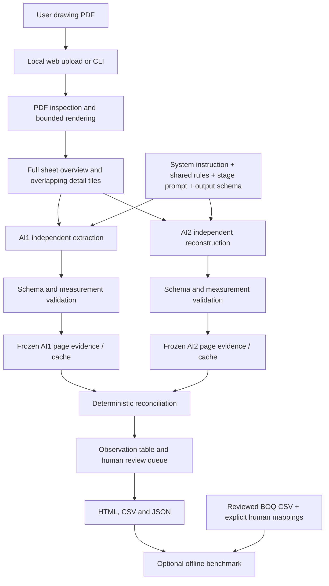

# Builtii architecture

This document describes the implemented application. It does not claim that a
multi-user platform or calibrated accuracy system has already been built.

## Drawing-to-quantity flow



There is no BOQ input to either AI pass and no arrow from benchmark results back
to extraction. AI2 does not receive AI1 output. Its audit consists of independent
reconstruction followed by deterministic comparison of the two frozen readings.
There is no additional model call that edits AI1 quantities after seeing a BOQ.

## Code map

```text
Builtii/
  main.py                 # Commands: serve, extract, evaluate
  config.py               # Models, environment settings and input limits
  ARCHITECTURE.md
  README.md
  requirements.txt
  pipeline/               # Processing and audit logic
    runner.py             # Coordinates the complete workflow
    pdf_processor.py
    prompt_loader.py
    gemini_service.py     # Shared API adapter for AI1 and AI2
    validator.py
    audit_engine.py
    report_generator.py
    boq_evaluation.py     # Evaluation only; not part of extraction
  prompts/                # Actual model instructions
    construction_takeoff_prompt.md
    ai2_audit_prompt.md
    shared_rules.md
    system.md
  schemas/
    takeoff_schema.json   # Actual response contract used by both models
  web/
    app.py
    static/
  tests/
  docs/                   # Review findings and accuracy/validation notes
  output/                 # Generated at runtime; not committed
```

Python package marker files (`__init__.py`) allow the folders and their assets to
be included in an installable distribution. They are not extra processing stages.

| File | Implemented responsibility |
| --- | --- |
| `main.py` | `serve`, `extract` and separate `evaluate` commands. |
| `config.py` | Shared model selection, process environment settings and PDF limits. No embedded credentials. |
| `web/app.py` | Local upload endpoint, one active web job, background execution, persisted status and allowed report artifacts. |
| `web/static/` | Upload/progress interface; no model credentials in browser code. |
| `pipeline/pdf_processor.py` | PDF validation, overview, overlapping 220 DPI tiles and page previews; explicit resource limits. |
| `pipeline/prompt_loader.py` | Loads actual Markdown prompt assets, composes stage prompt with page metadata and schema, hashes prompt assets. |
| `prompts/` | System, shared drawing rules, AI1 role and AI2 role used by API requests. |
| `pipeline/gemini_service.py` | Gemini HTTPS requests, images, bounded transient retries, response completion checks and sanitized failures. |
| `schemas/takeoff_schema.json` | Single authoritative JSON response contract for both AI passes. |
| `pipeline/validator.py` | Loads that schema, validates source rectangles, computes decimal arithmetic and checks dimensions. |
| `pipeline/runner.py` | Source/configuration fingerprints, per-page execution, validated cache reuse, failure retention and report generation. |
| `pipeline/audit_engine.py` | Item correspondence, independent quantity comparison, AI2-only findings, duplicate warnings and review reasons. |
| `pipeline/report_generator.py` | Portable HTML with source highlights, spreadsheet-safe CSV and page/region review queue. |
| `pipeline/boq_evaluation.py` | Offline reviewed-reference comparison with run-bound mappings; never calls a model. |
| `tests/` | Synthetic behavior tests and injected provider fixtures; never used as production fallback data. |

## Actual prompt composition

The API's `systemInstruction` comes from `system.md`. Image messages carry the
overview and every detail tile, labelled with full-page bounds. The text following
the images is composed in this order:

1. `construction_takeoff_prompt.md` or `ai2_audit_prompt.md`.
2. Requested page index and total pages, supplied by Python.
3. `shared_rules.md`, which contains the detailed extraction and uncertainty rules.
4. `schemas/takeoff_schema.json`, loaded as `validator.PAGE_SCHEMA`.

The individual role files are deliberately short. The full instruction is their
composition with the shared rules and schema; reading the role file alone does
not show the complete request. `pipeline/gemini_service.py:Gemini.extract` is the
actual call site. The JSON schema is used for both prompt composition and response
validation; there is no second schema definition embedded in Python. The old V2
prompt/schema contract is not used.

## Observation contract

Both extractors return the same shape: page and sheet metadata, coverage, review
regions and items. Every item includes description, work scope/action, unit,
printed asset identity/context if available, representation, measurement inputs,
source quotes/locations/bounds, reading quality and uncertainty reasons.

An item is an observation of one occurrence or one explicitly printed aggregate.
Quantities are computed from supported operands. An unresolved measurement stays
null. It is not replaced with zero, a typical quantity or a reference BOQ value.
Existing-to-remain, schedules, overview totals and generic details do not become
supported installation quantities automatically.

## Independent evidence matching

Within each page, the engine requires equal normalized scope and unit. It then
requires matching printed asset ID plus context, or overlapping source rectangles
with an equal normalized location. Quantity values are not used to select matches.
Only unique one-to-one candidates are compared. Many-to-many matches remain
review-required. Unmatched AI2 observations remain visible as possible omissions.

Repeated asset identities across pages and repeated same-scope observations with
unknown identity receive duplicate warnings. The engine does not automatically
deduplicate them or sum them into a payable project quantity. This conservative
policy can produce many review rows; semantic matching and cross-sheet reasoning
are not implemented as hidden assumptions.

## Evidence tiers and human review

`supported` means both readings are clear and located, scope/identity match
uniquely, quantities agree, the representation is installation, work action is
known and the basis is printed quantity or count. Calculated quantities, unresolved
regions, ambiguous readings, mismatches, missing pages and possible repeats are
`review_required`. Both reported values and source records are preserved.

These are evidence tiers, not measured high/low accuracy percentages. Two model
calls can agree on the same mistake. `accuracy_percentage` remains null until a
proper labelled validation process exists. The UI supports inspection and export;
it does not yet implement authenticated engineer decisions or sign-off history.

## Runtime and storage

CLI runs live under `OUTPUT/RUN_ID/`. Web jobs store `output/JOB_ID/drawing.pdf`,
`status.json` and `runs/RUN_ID/`. A run manifest records source SHA-256, models,
engine/configuration code hash, prompt file hash, schema file hash, rendering
version and page count. Their
combined fingerprint determines the run/cache directory.

Each successful page is cached separately for AI1 and AI2. Cache reuse revalidates
the schema. Failed responses do not become successful cache entries. Errors and
missing pages produce incomplete reports and review entries. Server restarts do
not preserve active threads or API requests; the CLI can resume completed cached
pages. This is a local single-user application, not a durable distributed queue.

## Benchmark boundary and remaining production work

Evaluation accepts a reviewed BOQ CSV and explicit item-to-observation mappings
bound to a run ID. It rejects duplicate allocation and unit conflicts, reports
unmapped/review-blocked rows, and separates comparison coverage from exact numeric
agreement. This cannot establish model accuracy by itself.

Production work remains: tenant authentication and isolation, durable jobs and
storage, PDF processing isolation, quotas, reviewer decisions with audit history,
cross-sheet dependency handling and an engineer-reviewed real-drawing benchmark.
See [accuracy validation](docs/ACCURACY.md) and [checks actually performed](docs/VALIDATION.md).
