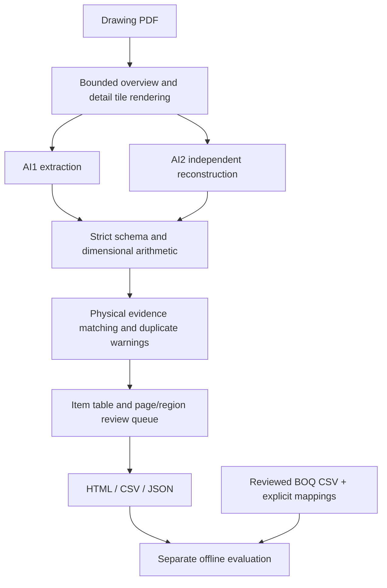

# Builtii — drawing takeoff and independent audit

A clean replacement for the uploaded V2 prototype. Users upload **drawings only**.
AI1 extracts quantities and evidence; AI2 independently reads the same drawings;
the engine reconciles the two frozen results into an item table and human review
queue. BOQs are optional, held-out evaluation inputs and cannot enter extraction.

## Architecture and actual prompts

- [Architecture, component map and data flow](ARCHITECTURE.md)
- [AI1 extraction prompt](prompts/construction_takeoff_prompt.md)
- [AI2 independent audit prompt](prompts/ai2_audit_prompt.md)
- [Shared drawing extraction rules](prompts/shared_rules.md)
- [System instruction](prompts/system.md)
- [Actual output schema](schemas/takeoff_schema.json)
- [Schema and arithmetic validation](pipeline/validator.py)

These Markdown prompt files are loaded by the application at runtime. Both AI
passes receive their own role, the shared rules, page metadata and strict output
schema. Restart the server after editing prompts. Their content hash is included
in cache identity so changed prompts cannot reuse results from an earlier version.

This release is a runnable local workbench and backend foundation. It is not a
complete Civils.ai equivalent, a production multi-user SaaS, or a demonstrated
high-accuracy takeoff system. No real project drawings or reference BOQs were
included in the source archive. Live model quality has not been measured.

## Run

Use a fresh folder when downloading this version. Do not extract it over the old
V2 folder: doing so leaves retired modules, historical scripts and bytecode in
place. Keep your original drawings, outputs and credentials separately. The old
`main.py --pdf ...` flags and V2 caches are not supported; use the commands below.
The previous rewrite's `python -m builtii` commands are now `python main.py`.

Python 3.11+ (validated on Python 3.12). From this directory:

```bash
python -m venv .venv
# Linux / macOS:
source .venv/bin/activate
# Windows PowerShell instead: .venv\Scripts\Activate.ps1
# Windows Command Prompt instead: .venv\Scripts\activate.bat
python -m pip install -r requirements.txt
```

Copy `.env.example` to `.env` beside `config.py` and set `GEMINI_API_KEY` there,
or configure it securely in the server process environment. Existing environment
variables take precedence over `.env`. Installed commands fall back to `.env` in
the working directory when no project-side file exists. Restart after editing.
The real `.env` is excluded from Git and must never be shared. Optional
`GEMINI_MODEL` and `GEMINI_AUDIT_MODEL` select the two models (both default to
`gemini-2.5-pro`; confirm model availability for your account). Using different
models can reduce correlated mistakes but does not establish independence of
training or calibrated confidence. Outbound HTTPS must allow
`generativelanguage.googleapis.com`. Preserve proxy and TLS trust settings.

```bash
python main.py serve --port 8000 --data-dir output
```

Open the local workbench in your browser on port 8000. Upload an unencrypted PDF,
wait for both passes, then open the quantity table. Expand each row to inspect
quotes, page regions and review reasons. Download CSV or the complete JSON.
The local server accepts one job at a time. Two model requests may run concurrently
per page; model usage is billable. Never expose this unauthenticated workbench to
the Internet. No third-party browser assets or remote scripts are used.

CLI workflow:

```bash
python main.py extract /path/to/drawing.pdf --output output/runs
# Retry the identical command: valid cached pages are reused, failed calls retried.
# --force intentionally refreshes both passes and incurs API usage.
```

Exit status: `0` means processing completed; `2` means a partial report was saved
with failed extraction pages; `1` means input/configuration/evaluation failure.
Processing completed does not mean all quantities are supported or approved.

## What the table means

| Field/status | Meaning |
| --- | --- |
| AI1 quantity | Value computed from AI1's supported measurement inputs; blank when unresolved. |
| AI2 quantity | Independently extracted value; never substituted silently for AI1. |
| Supported | Unique same-scope evidence match, clear located sources, explicit installation representation, printed/integral count basis and equal quantities. |
| Review required | Disagreement, uncertain source, unmatched observation, ambiguous identity, calculation assumptions, repeated representation or incomplete page. |
| AI2-only | Possible AI1 omission, retained in the table; not automatically accepted. |
| Page/region review | Failed, unreadable, partial or ambiguous drawing areas. Null bounds mean review the whole page. |

“Supported” is an evidence agreement tier, **not an accuracy probability**. No
unvalidated 95%/99% scores appear. `accuracy_percentage` remains null. All items,
including supported items, need appropriate professional approval before use.
The workbench flags review work; it does not record engineer sign-off or edit
quantities in place. Raw model evidence remains available in JSON/cache files.

The engine intentionally does not produce automatic project totals. A schedule,
plan/profile pair and summary may describe the same asset. It retains these as
observations and flags possible repeats instead of adding or subtracting guessed
quantities. Unknown identities, cross-sheet references and semantically different
model wording often need human resolution. This favors review over false certainty.

## Workflow



Full-sheet overview preserves context. Overlapping 220 DPI tiles preserve small
annotations without shrinking a large sheet to four fixed quadrants. Source
rectangles use normalized full-page coordinates so the review report can highlight
the original location. Rendering is limited to 64 tiles per sheet; oversized sheets
fail visibly rather than being silently downsampled. PDFs are limited to 100 MiB
and 200 pages. No pixels-to-world scale inference is performed.

Printed values and counts require matching units; EA counts must be integral.
Sum/difference require equal units. Products require dimensional compatibility
(for example M × M → M2). Mixed-unit conversions are not guessed. Calculated
quantities remain review-required even when arithmetic agrees. Source quotes and
dimensions are model observations, not machine-verified readings of drawing text.

## Optional BOQ benchmark (offline only)

Use a **human-reviewed CSV** with `item_no,description,quantity,unit`. Decimal
quantities use a period and no thousands separators. Item numbers need not be
sequential. PDF BOQ transcription is deliberately excluded from the benchmark:
an incorrectly transcribed reference would conceal extraction errors.

Create a mapping file against the `run_id` in `report.json`. Mappings are human
assertions of payable scope, not automatic description-based matches:

```json
{
  "run_id": "COPY_THE_FULL_RUN_ID_FROM_REPORT_JSON",
  "items": {
    "YOUR_REFERENCE_ITEM_NUMBER": ["p1-ai1-1"]
  }
}
```

```bash
python main.py evaluate --report output/runs/RUN_ID/report.json \
  --reference /path/to/reviewed_boq.csv --mapping /path/to/mapping.json \
  --output output/evaluation.json
```

Only mapped, supported observations from a completely processed drawing are
compared. Unknown IDs, duplicate allocation and conflicting units are rejected.
Review-blocked and unmapped reference rows remain visible. Coverage and exact
agreement are separate metrics; a low-coverage perfect agreement is not overall
accuracy. Unallocated drawing observations are listed. BOQ evaluation never
changes drawing evidence or sends BOQ rows to a model.

## Outputs and resuming

Each CLI run is addressed by PDF content, model configuration, rendering version
and actual engine code hash. Different contents with the same filename cannot
reuse stale caches. Cached pages are schema-validated on reuse. Corrupt caches
are reprocessed. Only successful pages are cached; failed forced refreshes remove
their old cache. Copy the entire run directory when sharing the portable report:

```text
RUN_ID/
  manifest.json
  cache/ai1-N.json, ai2-N.json
  previews/N.png
  report.html
  report.json
  quantities.csv
```

Web jobs store their PDF and runs under `output/JOB_ID/`. Server restarts do not
resume in-flight requests automatically. A saved status reports interruption.
Resume a web job using the CLI with its exact paths:

```bash
python main.py extract output/JOB_ID/drawing.pdf --output output/JOB_ID/runs
```

The CLI writes the resumed report in the run directory; it does not update the
web job status. Open that report from disk. Do not run simultaneous CLI processes
against the same output tree. Use existing checkouts in cloud tasks; no worktree
is required. Reports/caches contain project data; manage retention and sharing.

## Validation

```bash
python -m pip install -r requirements-dev.txt
python -m unittest discover -v
```

Interface tests additionally require `requirements-dev.txt`. Tests use explicitly
synthetic drawings and an injected fake provider. They verify pipeline behavior,
not the model's ability to read real engineering designs. See
[validation evidence](docs/VALIDATION.md), [source review and cleanup](docs/REVIEW.md)
and [accuracy validation plan](docs/ACCURACY.md).

For production, add tenant authentication/authorization, durable queues, storage
isolation/retention, PDF processing isolation, quotas, review/sign-off history and
an engineer-reviewed representative benchmark before making accuracy claims.
